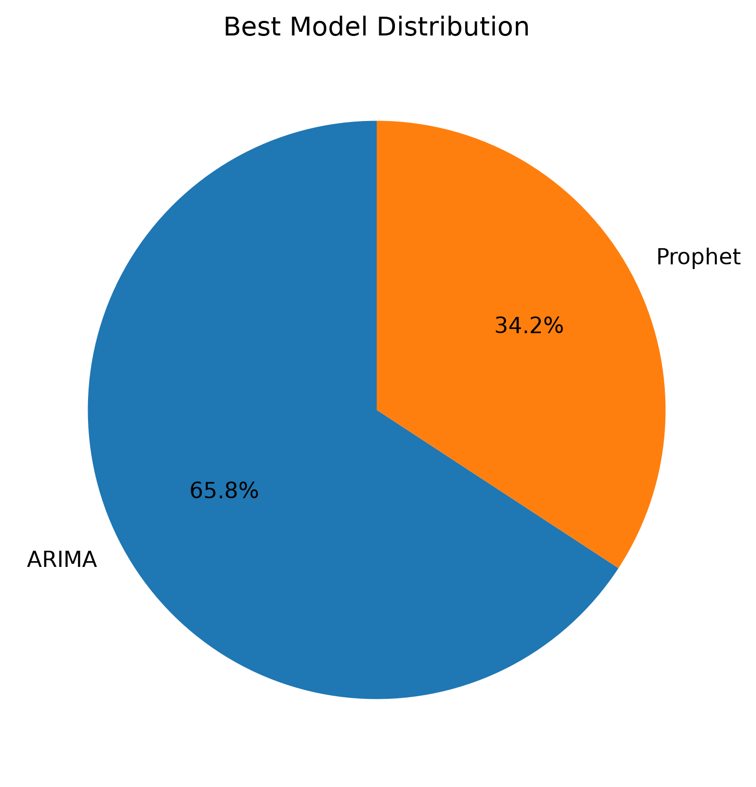
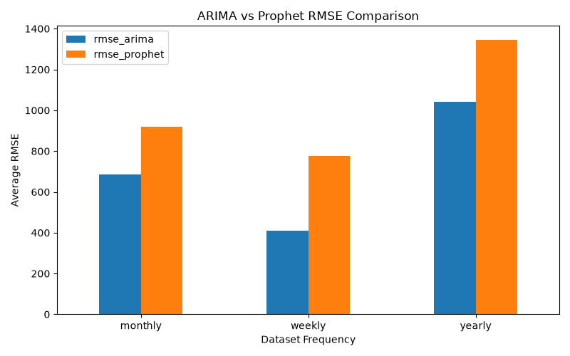
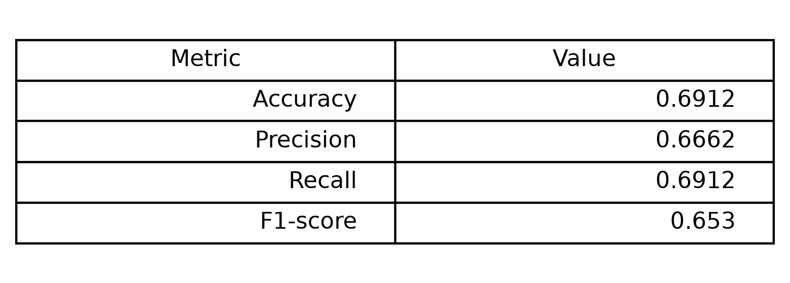
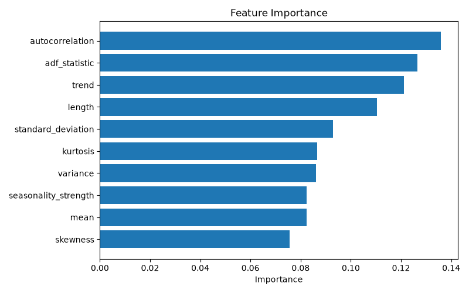
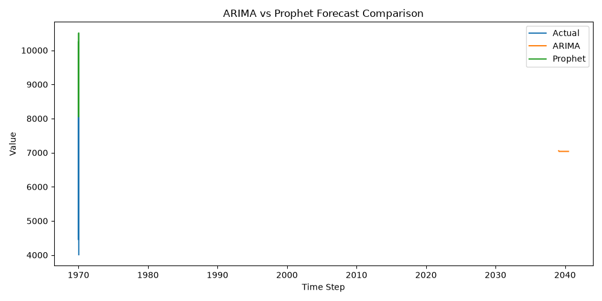

# Meta-Learning for Time Series Forecasting

An end-to-end meta-learning framework that automates time-series model selection between ARIMA and Prophet. By extracting statistical meta-features from historical series and evaluating baseline models against ground-truth horizons on the M4 benchmark, the system trains a Random Forest meta-classifier to recommend the most accurate forecasting model for unseen datasets without requiring costly trial-and-error model fitting. This solution is designed for data science teams and machine learning engineers managing large catalogs of heterogeneous time series where no single forecasting algorithm consistently dominates.

---

## Problem Statement

Selecting the best forecasting algorithm for time series data is typically an expensive, manual process. Models like ARIMA excel on stationary or autocorrelated data with clear autoregressive dynamics, whereas Prophet handles trends and seasonality changes through generalized additive models. In practice, real-world data portfolios contain hundreds or thousands of series varying in length, noise, trend strength, and stationarity, meaning neither model is universally superior. Training and tuning multiple candidates for every series at scale creates significant computational overhead. This project solves that bottleneck by treating algorithm selection as a supervised meta-learning task: statistical properties extracted directly from a series predict whether ARIMA or Prophet will achieve lower forecast error.

---

## Why This Project? (STAR Method)

- **Situation**: Organizations forecasting thousands of metrics often default to a single model family or fit multiple models per series, wasting compute and resulting in suboptimal accuracy across heterogeneous time series.
- **Task**: Design an automated meta-learning pipeline using the M4 benchmark dataset to extract statistical signatures from training series, evaluate ARIMA and Prophet on official test horizons, and train a lightweight meta-model to predict the winning forecaster for unseen series.
- **Action**: Built an end-to-end Python pipeline spanning 1,359 benchmark series across Monthly, Weekly, and Yearly frequencies. Engineered 10 statistical meta-features (including ADF test statistics, lag-1 autocorrelation, and polynomial trend slope), fit ARIMA(1, 1, 1) and Prophet baselines, calculated RMSE against actual test horizons, and labeled winning models. Trained a stratified Random Forest classifier and developed a Streamlit application supporting batch wide-CSV inference, confidence scoring, feature inspection, and interactive holdout validation.
- **Result**: Constructed a 1,359-sample meta-dataset showing ARIMA won on 894 series (65.8%) and Prophet on 465 series (34.2%). The meta-classifier achieved 69.12% holdout test accuracy, identifying autocorrelation, stationarity, and trend as primary decision drivers while providing instantaneous recommendations and probabilistic confidence scores for uploaded user data.

---

## Key Features

- **Automated Meta-Feature Extraction**: Computes 10 statistical properties per series, including length, mean, variance, standard deviation, linear trend slope, lag-1 autocorrelation, skewness, kurtosis, seasonality strength proxy, and Augmented Dickey-Fuller (ADF) stationarity statistic.
- **Dual Baseline Evaluation**: Implements standardized ARIMA(1, 1, 1) and Facebook Prophet models evaluated strictly against the official M4 test horizons.
- **RMSE-Based Ground Truth Labeling**: Dynamically compares root mean squared error between forecasts and ground truth to label each training sample with the superior model.
- **Random Forest Meta-Classifier**: Trains a shallow, regularized ensemble classifier (max depth 6, 200 estimators) on the meta-dataset with stratified validation and complete-dataset deployment retraining.
- **Batch Dataset Inference**: Ingests wide-format CSVs (row-wise series with identifiers and observation columns), validates numeric entries, and extracts features for batch classification.
- **Prediction Confidence Scoring**: Emits class probabilities alongside categorical recommendations, flagging marginal decisions versus high-confidence predictions.
- **Dataset-Level Aggregation**: Summarizes batch uploads with total series counts, individual model vote distributions, average confidence, and majority model recommendations.
- **Interactive Holdout Validation**: Includes a Streamlit interface allowing users to inspect individual series meta-features, probabilities, and run an on-demand 80/20 train-test split comparison with visual forecast overlays.
- **Artifact and Metadata Persistence**: Serializes the trained classifier (`random_forest.pkl`), schema metadata (`feature_columns.json`), feature importances (`feature_importance.csv`), and evaluation plots.

---

## Project Architecture

```
M4 Benchmark Raw Data (Monthly, Weekly, Yearly)
    │
    ▼
M4 Loader & Preprocessing (Date index assignment & numeric cleaning)
    │
    ├─────────────────────────────────────────┐
    ▼                                         ▼
Feature Extraction                   Train ARIMA & Prophet
(10 Statistical Meta-Features)       (Fit on train series only)
    │                                         │
    │                                         ▼
    │                                Forecast Test Horizon
    │                                         │
    │                                         ▼
    │                                Evaluate RMSE vs Test
    │                                         │
    └────────────────────┬────────────────────┘
                         ▼
             Construct Meta-Dataset
             (Features + Lower-RMSE Label)
                         │
                         ▼
             Train Random Forest Meta-Model
             (Stratified split evaluation & full retrain)
                         │
                         ▼
             Save Model & Feature Schema
             (random_forest.pkl & feature_columns.json)
                         │
                         ▼
             Inference Engine & Streamlit Application
             (Batch CSV upload, confidence scores & forecast comparison)
```

---

## Tech Stack

| Category | Technology | Purpose |
|---|---|---|
| Language | Python 3.12 | Core implementation across pipeline, modeling, and application |
| Data Processing | Pandas, NumPy | Tabular manipulation, wide-to-series extraction, array operations |
| Meta-Learning | Scikit-learn | Random Forest classifier, train/test splitting, evaluation metrics |
| Time Series Forecasting | Statsmodels | ARIMA modeling and Augmented Dickey-Fuller test |
| Time Series Forecasting | Prophet | Facebook Prophet forecasting model |
| Web Application | Streamlit | Interactive web UI for batch prediction and visual inspection |
| Visualization | Matplotlib | Plots for distributions, RMSE comparisons, and feature importances |
| Model Persistence | Joblib, JSON | Serializing trained model objects and feature schema metadata |
| Testing | Unittest | Automated testing for input extraction, batch inference, and summaries |

---

## Project Statistics

| Metric | Project Value |
|---|---|
| Benchmark Data Source | Official M4 Competition |
| Supported Frequencies | Monthly, Weekly, Yearly |
| Total Meta-Dataset Samples | 1,359 series |
| Monthly Series Evaluated | 500 series |
| Yearly Series Evaluated | 500 series |
| Weekly Series Evaluated | 359 series |
| Meta-Features Extracted | 10 features |
| Baseline Forecasters Compared | 2 (ARIMA vs Prophet) |
| Evaluation Metric | Root Mean Squared Error (RMSE) |
| ARIMA Winning Series | 894 series (65.78%) |
| Prophet Winning Series | 465 series (34.22%) |
| Monthly Average RMSE | ARIMA: 686.87 \| Prophet: 920.24 |
| Weekly Average RMSE | ARIMA: 410.70 \| Prophet: 777.63 |
| Yearly Average RMSE | ARIMA: 1040.92 \| Prophet: 1346.38 |
| Meta-Model Algorithm | Random Forest Classifier (max_depth=6, n_estimators=200) |
| Meta-Model Holdout Accuracy | 69.12% |
| Generated Visualizations | 5 plots |
| Persisted Artifacts | 1 model (`.pkl`), 1 schema (`.json`), 2 CSVs (`meta_dataset.csv`, `feature_importance.csv`) |

---

## Folder Structure

```
Meta-Learning-Time-Series-Forecasting/
├── app/
│   └── app.py                        # Streamlit web interface
├── data/
│   ├── processed/
│   │   └── meta_dataset.csv          # Generated meta-dataset (1,359 records)
│   └── raw/                          # Official M4 CSVs (train and test splits)
│       ├── test/
│       │   ├── Monthly-test.csv
│       │   ├── Weekly-test.csv
│       │   └── Yearly-test.csv
│       └── train/
│           ├── Monthly-train.csv
│           ├── Weekly-train.csv
│           └── Yearly-train.csv
├── models/
│   ├── feature_columns.json          # Meta-feature column schema
│   └── random_forest.pkl             # Trained Random Forest classifier
├── results/
│   ├── feature_importance.csv        # Ranked feature importance values
│   ├── plots/                        # Visual evaluation outputs
│   │   ├── arima_vs_prophet.png
│   │   ├── best_model_distribution.png
│   │   ├── classification_results_table.png
│   │   ├── feature_importance.png
│   │   └── rmse_comparison.png
│   └── scripts/                      # Evaluation and summary plotting scripts
│       ├── best_model_distribution.py
│       ├── classification_summary.py
│       ├── generate_plots.py
│       ├── plot_feature_importance.py
│       ├── rmse_comparison.py
│       └── summary.py
├── src/
│   ├── data/
│   │   ├── m4_loader.py              # M4 file loading utilities
│   │   └── preprocessing.py          # Series formatting, date ranges, and splitting
│   ├── evaluation/
│   │   └── metrics.py                # RMSE and MAE metric calculations
│   ├── features/
│   │   └── feature_extraction.py     # 10 statistical meta-feature extractors
│   ├── models/
│   │   ├── arima_model.py            # ARIMA(1, 1, 1) fit and forecast
│   │   ├── prophet_model.py          # Prophet fit and forecast
│   │   └── random_forest_meta_model.py # Meta-model training and evaluation
│   ├── pipeline/
│   │   ├── build_meta_dataset.py     # Meta-dataset creation across M4 frequencies
│   │   └── run_pipeline.py           # Master execution script
│   └── inference.py                  # Batch inference engine and validation helpers
├── tests/
│   └── test_inference.py             # Unit tests for inference and extraction
├── demo.csv                          # Example synthetic wide-format time series dataset
├── requirements.txt                  # Python package dependencies
└── README.md
```

---

## How It Works

1. **Benchmark Data Ingestion**: The data loader reads paired M4 train and test files for Monthly, Weekly, and Yearly series, parsing series IDs and numeric observation vectors up to the configured batch limit.
2. **Preprocessing**: Each training series receives a standard datetime index starting from an arbitrary reference point matching the series frequency (`MS`, `W`, or `YS`). Test series indices are assigned consecutively directly following the training horizon.
3. **Statistical Feature Engineering**: Meta-features are extracted strictly from the training observations to avoid data leakage. The system computes basic scale, dispersion, linear trend slope, lag-1 autocorrelation, distribution moments (skewness and kurtosis), lag-12 seasonal differences, and the ADF test statistic.
4. **Forecaster Training and Scoring**: ARIMA(1, 1, 1) and Prophet models are fit on the training series. Each model produces forecasts over the test length, and its RMSE is computed against the ground-truth test values.
5. **Meta-Dataset Construction**: Each series receives a record containing its extracted meta-features, frequency tag, individual model RMSEs, and a binary target label designating the model that achieved lower RMSE. The resulting 1,359 samples are saved to `data/processed/meta_dataset.csv`.
6. **Meta-Model Training**: A Random Forest classifier is trained on an 80/20 stratified split of the meta-features (excluding RMSE and frequency columns to prevent bias). Performance metrics are logged, and the classifier is refit on all 1,359 samples before serializing to disk.
7. **Production Inference and Validation**: New CSV files containing multiple series are processed by the inference engine, aligning extracted features to the saved schema. The classifier predicts the optimal algorithm with confidence probabilities. Within the Streamlit application, users can select any series to run an on-the-fly 80/20 holdout forecast to verify the recommendation against observed data.

---

## Results

The project produces several diagnostic and performance visualizations stored in `results/plots/`:

### Best Model Distribution



Shows the distribution of winning forecasters across the 1,359 evaluated M4 series, where ARIMA outperformed Prophet on 65.8% of the datasets.

### RMSE Comparison Across Datasets



Illustrates the comparative error profiles of ARIMA and Prophet across evaluated series, highlighting the variance in individual model accuracy across different series characteristics.

### Classification Results Summary



Summarizes the meta-model classification metrics on the holdout evaluation set, achieving a 69.12% accuracy and balanced precision and recall.

### Random Forest Feature Importance



Ranks the statistical meta-features by Gini importance, indicating that lag-1 autocorrelation, ADF stationarity, and trend slope are the strongest predictors of whether ARIMA or Prophet performs better.

### Forecast Comparison Sample



Demonstrates holdout predictions from both ARIMA and Prophet against actual benchmark values on a representative time series.

---

## Example Workflow

```
Input Dataset (Wide CSV: ID, V1, V2, V3...)
                    ↓
Meta-Feature Extraction (10 Statistical Features per Series)
                    ↓
Meta-Model Evaluation (Random Forest Classifier)
                    ↓
Confidence Scoring (Probabilities for ARIMA vs Prophet)
                    ↓
Overall Recommendation (Majority Vote & Series-Level Output)
```

---

## Example Output

### Batch Summary

```text
Predictions Generated : 5,000
ARIMA Recommendations : 3,842 (76.8%)
Prophet Recommendations: 1,158 (23.2%)
Average Confidence    : 72.4%
Overall Recommendation: ARIMA is the majority recommendation for 3,842 of 5,000 series (76.8%).
```

### Recommendation Table

| Series ID | Recommended Model | Confidence |
|---|---|---|
| M1 | ARIMA | 78.5% |
| M2 | Prophet | 64.2% |
| M3 | ARIMA | 81.0% |
| M4 | ARIMA | 71.3% |
| M5 | Prophet | 59.8% |

### Feature Importance Output (`results/feature_importance.csv`)

| Rank | Feature | Importance |
|---|---|---|
| 1 | autocorrelation | 0.1359 |
| 2 | adf_statistic | 0.1265 |
| 3 | trend | 0.1213 |
| 4 | length | 0.1105 |
| 5 | standard_deviation | 0.0929 |
| 6 | kurtosis | 0.0866 |
| 7 | variance | 0.0860 |
| 8 | seasonality_strength | 0.0825 |
| 9 | mean | 0.0823 |
| 10 | skewness | 0.0756 |

---

## Key Learnings

- **Meta-Learning Mechanics**: Implemented the concept of "learning to learn" by abstracting raw time-series data into fixed-dimension statistical vectors, transforming an empirical model selection challenge into a standard supervised tabular classification task.
- **Forecasting Inductive Biases**: Verified through empirical M4 testing that ARIMA's reliance on autoregression and differencing makes it superior on short or stationary data, while Prophet's trend changepoints and harmonic seasonal components benefit series with explicit long-term shifts.
- **Data Leakage Mitigation**: Ensured statistical features and forecasting models were computed exclusively on training windows, maintaining total isolation from the test horizons used for ground-truth RMSE labeling.
- **Inference Robustness**: Designed schema-validation safeguards and error-tolerant batch routines in `src/inference.py` to handle non-numeric values, irregular series lengths, and degenerate series without breaking pipeline execution.
- **Production-Oriented Architecture**: Separated offline benchmark processing and meta-dataset generation from online lightweight inference, enabling instant model recommendations in the UI without running heavy training loops.

---

## Resume Highlights

- Engineered an end-to-end Python meta-learning pipeline that automates time-series model selection between ARIMA and Prophet across 1,359 M4 benchmark datasets.
- Developed a statistical feature extraction engine computing 10 time-series meta-features including ADF stationarity, lag-1 autocorrelation, and polynomial trend slope.
- Evaluated ARIMA(1, 1, 1) and Prophet baselines on official test horizons, establishing RMSE ground truth where ARIMA led on 65.8% of series.
- Trained a Random Forest meta-classifier achieving 69.12% holdout accuracy and isolated lag-1 autocorrelation and ADF statistics as top predictive drivers.
- Implemented a production inference engine and Streamlit web dashboard supporting wide-CSV batch processing, confidence scoring, and interactive 80/20 forecast comparisons.
- Authored automated unit test suites covering edge cases in time series parsing, invalid observations, and batch summarization.

---

## Future Improvements

- **Broader Model Zoo**: Integrate additional forecasters such as Exponential Smoothing (ETS), XGBoost, LightGBM, CatBoost, and deep learning architectures (N-BEATS, PatchTST).
- **Hyperparameter Tuning**: Move beyond fixed orders (ARIMA(1, 1, 1)) to include AutoARIMA and optimized Prophet prior scales during meta-label generation.
- **Expanded Meta-Features**: Incorporate spectral entropy, Hurst exponent, PACF features, and STL-based trend/seasonal decomposition strengths.
- **Multi-Class Recommendations**: Support multi-class classification or regression-based RMSE estimation to rank three or more model candidates simultaneously.
- **Containerization and API Deployment**: Package the inference service in a Docker container and expose predictions via a FastAPI REST API.

---

## Installation

### Prerequisites

- Python 3.12
- Git

### Setup Steps

1. Clone the repository:
   ```bash
   git clone https://github.com/saichetanreddy07/Meta-Learning-Time-Series-Forecasting.git
   cd Meta-Learning-Time-Series-Forecasting
   ```

2. Create and activate a virtual environment:
   - On Windows (PowerShell):
     ```powershell
     python -m venv venv
     .\venv\Scripts\Activate.ps1
     ```
   - On macOS/Linux:
     ```bash
     python -m venv venv
     source venv/bin/activate
     ```

3. Install required dependencies:
   ```bash
   python -m pip install --upgrade pip
   python -m pip install -r requirements.txt
   ```

4. Benchmark Data Setup (Optional for inference, required to re-run pipeline):
   Place the official M4 CSV files into the corresponding directories:
   ```text
   data/raw/train/Monthly-train.csv
   data/raw/train/Weekly-train.csv
   data/raw/train/Yearly-train.csv
   data/raw/test/Monthly-test.csv
   data/raw/test/Weekly-test.csv
   data/raw/test/Yearly-test.csv
   ```

---

## Running the Project

### 1. Execute the End-to-End Pipeline

To regenerate the meta-dataset, retrain the Random Forest classifier, and generate visualization plots:

```bash
python src/pipeline/run_pipeline.py
```

### 2. Launch the Streamlit Web Application

To run the interactive recommendation interface:

```bash
streamlit run app/app.py
```

Once running, upload any wide-format CSV (or use `demo.csv`) containing an identifier column followed by sequential numeric observations.

### 3. Generate Synthetic Demo Data

To produce a sample wide-format CSV containing 5,000 synthetic time series:

```bash
python demo.py
```

### 4. Run Automated Tests

To run the inference and data validation test suite:

```bash
python -m unittest discover tests
```

---

## Repository Highlights

This project demonstrates strong practical capabilities across several core machine learning engineering competencies:

- **Machine Learning**: Practical formulation of a meta-learning classification task, avoiding data leakage, performing stratified holdout validation, and interpreting model metrics.
- **Time Series Forecasting**: Hands-on implementation of foundational statistical (ARIMA) and additive (Prophet) forecasting architectures evaluated under rigorous benchmark conditions.
- **Feature Engineering**: Extraction of statistical, temporal, and distribution-based signatures from non-stationary sequential data.
- **Software Engineering**: Clean modular architecture following PEP-8, reusable helper functions, decoupled inference logic, automated unit testing, and input validation.
- **Full-Stack ML Delivery**: Bridging offline dataset generation and model training with a responsive, user-facing Streamlit dashboard for real-time model recommendation.
